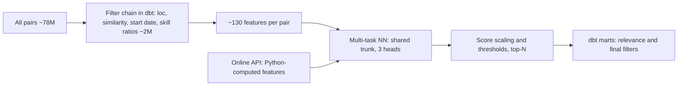

# Course 1 · Chapter 1.1: The system — two-stage ranking, batch vs online

_Andrey Popov's project notes: how it works, why it was built this way, and the theory behind it._

**In short:** How the matching system works end to end: rule-based dbt filters cut about 78M candidate-position pairs to about 2M, then a multi-task neural ranker scores them. Batch nightly plus an online path with a training/serving skew risk.

## 2. The problem (business view, plain English)

Staffing managers need a shortlist of internal candidates for each open position. Resource managers need the reverse: the best positions for a given employee. Doing this by hand does not scale. The system produces ranked lists automatically, in scheduled batches and on demand. The business measure is how often top-ranked candidates actually get proposed.

The hard part is size. One forecast run touched about 78M candidate–position pairs after the first (location) filter, about 2M after the similarity filter. Scoring every possible pair with a neural network is wasteful. Scoring only a clean subset is cheap.

## 4. How it works (technical walkthrough)

```
 10+ source systems
        │
        ▼
 STAGE 1  the forecast dbt project on BigQuery  — "candidate generation" (cheap, rule-based, recall-oriented)
   all pairs ──► filter by location ──► by similarity ──► by start date ──► skill ratios
   (≈78M)          the location filter step  → …the similarity filter → …the start-date filter step   (≈2M after similarity)
        │           ▲ my Rules 1–3 are WHERE clauses INSIDE these existing models (2844:18–60)
        ▼
   feature assembly: ~120–130 features per surviving pair
        │
        ▼  BigQuery table → GCS export → local memmap
 STAGE 2  PyTorch multi-task network — "ranking" (expensive, learned, precision-oriented)
   split num / emb / bag inputs → BatchNorm / embeddings → FC tower → 3 heads (logits)
        │
        ▼
   scores: sigmoid → dual-channel gate (≥0.85) → exp scaling to 0–100
   three-tier thresholds (40 / 70 / 3) → top-N (200 per position, 100 per employee)
        │
        ▼  write to BigQuery → dbt post-processing: relevance score, mart filters
   final marts: the final candidates-per-position table, the final positions-per-employee table, the final opportunity table  ← the three "terminal marts" (Ch 1.3)

 ONLINE SIDE-PATH (position edited by a user, or a Kafka event)
   HTTP → SQL load ‖ NER skills → 24 features in Python (the online feature module) → CPU inference → threshold → Kafka
```



**Two things that surprise people.** (1) dbt appears *twice*: before the model (filters + features) and after it (relevance score + mart filters). (2) The online path **recomputes 24 features in Python** and **zero-fills 13 columns** as placeholders, while batch gets them from dbt. That is the skew risk (§6.5).

## 5. Why it was built this way (decisions and trade-offs)

| Decision | Alternatives considered | Why this one | Cost / risk |
|---|---|---|---|
| Filter first, rank second | Score all pairs | Keeps the pair space tractable | A pair the filter drops can never be recommended: the filter sets a **recall ceiling** |
| Rules as SQL filters in dbt | Python post-filter | Business rules auditable by analysts; BigQuery handles scale | Logic split across SQL, Python thresholds, and a separate SQL funnel in similar-candidates |
| One multi-task network | 3 separate models | Shared signal (skill, geo, seniority), one pipeline | Negative transfer risk; per-mode feature exclusions complicate the "one model" story |
| Uncertainty-weighted loss + focal loss | Hand-tuned weights; plain BCE | Auto task balance; rare positives | Weights are learned, so harder to explain to a business user |
| Batch *and* online | Batch only | Recruiters need instant re-ranking after an edit | **Features defined twice → skew risk** |
| CPU for online, GPU for batch | GPU everywhere | Small request batches: GPU overhead exceeds benefit | Two inference code paths |

## 6. Theory behind it (the "lecture" part)

### 6.1 The funnel: candidate generation vs ranking
Many production recommenders and search systems are **cascades**: stage k keeps a subset of stage k−1's output and uses a more expensive scorer.

- Let *N* = number of employees, *M* = open positions. The full pair space has size *N·M*. A model with per-pair cost *c_m* costs *N·M·c_m*; a cascade costs *N·M·c_f + K·c_m*, where *c_f ≪ c_m* is the filter cost and *K* is the survivor count. The cascade wins when *K ≪ N·M*.
- The price is the **recall ceiling**: if the filter keeps a fraction *r* of the truly good pairs, then no ranker, however good, can exceed recall *r*. Total recall = *r_filter × r_ranker*. Filters must therefore be conservative (high recall) and the ranker precise.
- Classical vocabulary: Stage 1 = *candidate generation / retrieval / blocking* (record-linkage term); Stage 2 = *ranking*; a stage 3 for business rules and diversity is common ("re-ranking"). Here stage 3 is the dbt mart filters.
- **In my project:** the dbt filter chain is stage 1 (78M → 2M, review §4); the network is stage 2; relevance score and mart filters are stage 3. My exclusion rules *tighten stage 1*, so any false exclusion lowers the recall ceiling. That is why Rule 3 uses fail-open defaults (Ch 1.4).

### 6.2 Learning to rank (LTR)
Three families:

| Family | Loss acts on | Example |
|---|---|---|
| Pointwise | one item: predict relevance | logistic regression, BCE / focal loss |
| Pairwise | item pairs: order preferred above other | RankNet, LambdaRank |
| Listwise | the whole list | ListNet, LambdaMART (optimizes NDCG directly) |

Ranking metric: **NDCG@k** = DCG@k / IDCG@k, with DCG@k = Σ_{i=1..k} (2^{rel_i} − 1) / log₂(i+1). It rewards putting relevant items near the top.
- **In my project:** the network is trained *pointwise* (per-pair sigmoid + focal loss). Ranking happens by sorting scores and cutting top-200 / top-100. The team evaluates with NDCG and proposal-rate@10 offline. My review suggests a LightGBM LambdaRank baseline as a challenger.

### 6.3 Multi-task learning (MTL)
**Hard parameter sharing:** one trunk *f_θ(x)* feeds *T* heads, *ŷ_t = g_t(f_θ(x))*. Total loss *L = Σ_t w_t L_t*. Benefits: shared data efficiency, implicit regularization. Risk: **negative transfer** (tasks pull the trunk in conflicting directions).
- **Kendall et al. (2018) uncertainty weighting.** Treat each task's noise σ_t as learnable. With *s_t = log σ_t²*: *L = Σ_t [ e^{−s_t} L_t + s_t ]* (up to a ½ factor). A noisy task gets a large *s_t* → low weight; the additive *s_t* term stops all weights collapsing to zero. This matches the code pattern described at.
- **Focal loss (Lin et al. 2017):** *FL(p_t) = −α_t (1 − p_t)^γ log p_t*. At γ = 0 it is plain cross-entropy; larger γ down-weights easy examples. Here γ = 1 and per-sample masking handles missing labels per task.
- **In my project:** 3 heads, learned task weights, focal loss for rare positives. *Which* three tasks the heads are is unresolved in the sources.

### 6.4 Batch vs online serving
| | Batch | Online |
|---|---|---|
| Freshness | stale by hours | seconds |
| Throughput | very high, scheduled, GPU | one request, CPU |
| Cost per prediction | very low | higher |
| Failure mode | late/missed run | latency, timeouts, partial inputs |

Rule of thumb: *precompute what is expensive and stable, compute live what changes on user action.* The hybrid is sometimes called a Lambda-style architecture.
- **In my project:** nightly batch for all positions; Flask API (<2 s) when a recruiter edits a position.

### 6.5 Training/serving skew
Definition: the model sees different *feature distributions or definitions* at serving than at training. Three kinds:
1. **Schema/definition skew:** the same feature computed by two code paths (SQL vs Python) that drift apart.
2. **Data skew:** serving data has missing, stale or defaulted values (e.g. placeholders).
3. **Distribution drift:** the world changes over time (covariate shift: *P_train(x) ≠ P_serve(x)*).

Detection: log serving features and compare to training distributions (PSI, KS test); **parity tests** on a golden dataset; **adversarial validation** (train a classifier to tell train from serve: AUC ≈ 0.5 means no detectable shift). Fix at the root: **one feature definition** (feature store) used for both.
- **In my project:** (a) 24 features recomputed in Python for online must match dbt ETL; "no shared feature store"; "no consistency check". (b) 13 online columns are zero/placeholder filled. (c) Skill-distance filter (ETL) and skill-distance feature (model) are separate implementations that "should use equivalent embeddings". (d) Team already uses LightGBM adversarial validation for *temporal* drift. So the team handles (3) but not (1)/(2).

### 6.6 Score calibration and scaling (short)
A sigmoid output is not automatically a calibrated probability, especially after focal loss or class re-weighting. Check with reliability diagrams or ECE. A monotone rescaling (the piecewise exponential here) *preserves ranking* but changes thresholds, so thresholds (40 / 70 / 3) must be set on the scale that is actually served.
- **In my project:** batch applies gating + exponential scaling; online applies `×100`. If both are right, the same pair can get different numbers on the two paths.

## 8. Glossary

| Term | One-line definition |
|---|---|
| Candidate generation | Cheap first stage that cuts the pair space to a manageable set |
| Ranking | Expensive second stage that scores survivors |
| Recall ceiling | Max recall the whole system can reach = what the first stage keeps |
| Pointwise / pairwise / listwise | What the loss looks at: one item / a pair / the whole list |
| NDCG@k | Rank-aware metric with log discount on position |
| Multi-task learning | One model, shared trunk, several output heads |
| Negative transfer | Tasks hurt each other through the shared trunk |
| Uncertainty weighting | Learned per-task loss weights (Kendall 2018) |
| Focal loss | Cross-entropy that down-weights easy examples |
| Training/serving skew | Model sees different features at serving than at training |
| Adversarial validation | Classifier that tries to tell train from test; AUC ≈ 0.5 = same distribution |
| Feature store | One place that defines and serves features to both training and serving |
| Memmap | Disk-backed array for data larger than RAM |
| Terminal marts | Final dbt output tables (the final candidates-per-position table, the final positions-per-employee table, the final opportunity table) |
