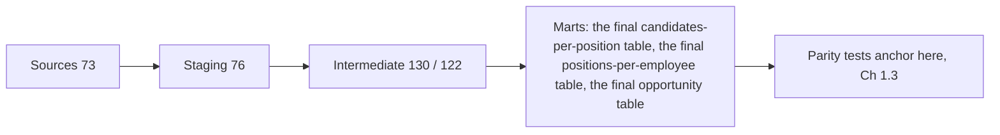

# Course 1 · Chapter 1.2: dbt on BigQuery — models, macros, tests, incremental MERGE

_Andrey Popov's project notes: how it works, why it was built this way, and the theory behind it._

**In short:** How the SQL data layer was restructured: about 650 dbt models on BigQuery, shared macros removing about 900 duplicated lines, tests from none to about 148. Incremental MERGE cut bytes scanned 94% on one model but not on the other.

## 2. The problem (business view, plain English)

The matching system's data layer is large: 6 dbt projects and about 650 models. A full forecast run scans about 1 TB in BigQuery. In the March snapshot there were no dbt tests at all. The same logic existed twice, once for each forecast variant, and some models had grown to 800–about 1,500 lines.

The risks were practical. New business rules had to go in, the SQL had to be restructured, and nobody could say with confidence that a change did not silently alter who gets recommended. Each experiment also cost real money, because every full build scans about a terabyte.

So the work in this chapter has three goals: make the SQL smaller and shared, make it testable, and cut rebuild cost where the data allows it.

## 4. How it works (technical walkthrough)

```
 sources: 10+ systems; 73 dbt sources in forecast
      │  source / ref
      ▼
 STAGING       76 models   one cleaned model per source
      ▼
 INTERMEDIATE  130 (RDR) / 122 (OPP)  joins, filter chain, features
      ▼
 MARTS         9 (RDR) / 6 (OPP)  → three terminal anchors:
               the final candidates-per-position table · the final positions-per-employee table · the final opportunity table
```



**4.1 One run.** Two variants of the forecast, RDR and OPP, run as two separate workflows. Each passes the variant as an environment variable, and variant-only models are switched on or off with `+enabled` gates. A build is "seed, then run": for example 7 seeds, then 214 models, with 4 threads by default. Almost everything is a `table`. One build summary reads "1 incremental model, 204 table models, 9 view models".

**4.2 Why the DAG got bigger on purpose.** Splitting four oversized models added 15 (RDR) and 11 (OPP) models, yet the most dependencies any model has fell from 23 to 18–19. the employees intermediate model went from 23 direct parents to 18, the positions intermediate model from 16 to 12. A side effect: the skills hub now has 30 children instead of 22.

**4.3 Incremental MERGE on train, step by step** (the booked-proposals model, about 1,500,000 rows):
1. The model is configured as incremental, with a composite key (the proposal id, the window-start column), strategy `merge`, and `on_schema_change` set to `fail` (a schema change stops the run).
2. The first run builds the whole table, like a normal `table`.
3. Later runs read only source rows whose the validity-start column is later than the largest the window-start column already in the table (with a 1900 fallback on the very first run).
4. dbt MERGEs those rows into the table by key: a matching key is updated, a new key is inserted.
5. Measured, with zero new rows: full rebuild 5.181 s and 1.47 GiB; MERGE run 6.846 s and 89.3 MiB. That is **−94.1% bytes and +32.1% time**.

It works on train because the source rows carry bitemporal columns almost everywhere, so there is a column to filter on.

**4.4 Incremental MERGE on forecast (the pilot).** The pilot model, the role-categorization model, was set up as incremental with the employee id as unique key, strategy `merge`, and **no incremental filter** (option "γ"). So it still selected every row and only changed *how* the result was written. Wall-clock went from 4.29 s to 9.95 s on RDR and 7.21 s to 9.16 s on OPP; the review rounds the RDR case to +131%. The reason for no filter: the model aggregates over moving windows (last 7 months, last 210 days, latest role), so its rows can change just because the clock moved, and no ingestion-time column was carried through staging. The model has 56 downstream models.

**4.5 How I measured.** I wanted slot-ms from BigQuery's job history, but the service account got a 403 (missing `bigquery.jobs.list`). So I took per-model wall-clock from dbt's own `run_results.json`. Pipeline totals moved +7.1% (RDR) and −6.4% (OPP) between baseline and final, which the sources call within run-to-run noise, so **no speed claim was made**.

**Two things that surprise people.** (1) A model can scan 99.86% fewer bytes and still run slower. (2) The parity checks made the final tables stop being leaf nodes in the DAG, because tests now point at them.

## 5. Why it was built this way (decisions and trade-offs)

| Decision | Alternatives considered | Why this one | Cost / risk |
|---|---|---|---|
| Layered staging → intermediate → marts | Not in the sources | Standard dbt layering | Hubs like central skills model get many children |
| Collapse RDR/OPP twin files into shared macros | Leave duplicates | About 900 duplicated lines removed; 7 of 8 collapses compiled to byte-identical SQL | Parse time +23% |
| Repeated CASE logic → UDFs, only with 2+ call sites | Keep inline | Each UDF checked equal to the old CASE over its whole input domain | Logic outside the model files |
| Constants → seeds, but compliance literals stay inline | Everything to seeds | Auditable constants; protected literals must stay visible | Three more seeds to maintain |
| Split 4 oversized models | Leave as is | Fewer dependencies per model (23 → 18) | More models; +36 s RDR / +26 s OPP at that family |
| Tags, source freshness, slim CI on `state:modified+` | Run everything | Select by tag; catch stale sources; test only what changed | CI runs without a saved manifest, so it is not downstream-aware |
| Incremental MERGE only where the source has a reliable change column | Incremental everywhere | Wrong filters silently break parity | Forecast pilot slower; train gain proven only with zero new rows |
| Wall-clock from `run_results.json`, not slot-ms | Wait for IAM grant | No dependency on IT; reproducible | Measurement runs themselves cost money |
| Path A control build to explain an 8.8% diff | Call it a bug or ignore | Two untouched rebuilds 15 min apart already differ 5.28%, so 8.8% over 26 min is source drift | 30 extra minutes of builds |

## 6. Theory behind it (the "lecture" part)

### 6.1 The dependency graph (DAG) and why it matters
A dbt project is a **directed acyclic graph**. Nodes are models, seeds, sources and tests. An edge means "B reads A", written with `ref` or `source`. dbt sorts the graph so every node runs after its parents (a *topological order*), and runs independent nodes in parallel up to the thread limit. Cycles are not allowed.

Useful measures:
- **In-degree** = number of direct parents. A very high value marks a "god model" that does too much.
- **Out-degree** = number of direct children. A high value marks a hub that many models depend on.
- **Blast radius** = all descendants. Changing a node can change all of them.
- **Run time bound.** With total node time *Σt* and *k* threads: *T ≥ max( critical path, Σt / k )*. Splitting a model adds nodes but can shorten the critical path.
- **Selectors.** `state:modified+` means "changed nodes plus their descendants". It is how a slim CI run tests only what a change can affect.

Finance analogy: a calculation graph in a risk system. Change one market-data input and everything downstream must be recomputed. The graph tells you what, and in which order.

**In my project:** in-degree 23 → 18, hub central skills model out-degree 22 → 30, the pilot model has 56 descendants.

### 6.2 Materializations
A materialization decides what dbt creates for a model.

| Type | What exists | You pay | Good when |
|---|---|---|---|
| `view` | a saved query | at every read | cheap, rarely read, always fresh |
| `table` | a full copy, rebuilt each run | at every build | read often; rebuild is cheap enough |
| `incremental` | a table updated with only new or changed rows | a small amount per run | big, growing, with a reliable change marker |
| `ephemeral` | nothing; the SQL is inlined as a CTE | at every read of the parent | tiny helper logic |

The choice trades **build cost against read cost against freshness**. In BigQuery a view's bytes are billed again on every query that touches it.

**In my project:** almost all models are `table`, a few are `view`, and exactly one on each side was made `incremental` as a pilot.

### 6.3 Incremental builds and MERGE
**Idea.** Do not rebuild what has not changed. On BigQuery the default strategy is `merge`: a single statement, *MERGE INTO target USING new_rows ON key WHEN MATCHED THEN UPDATE WHEN NOT MATCHED THEN INSERT*. Other strategies exist (`insert_overwrite` replaces whole partitions; newer dbt versions add `microbatch`, time-sliced builds). Check the dbt version before relying on a strategy; it is not in the sources.

**Four requirements for a correct incremental model:**
1. **A unique key**, so a re-delivered row updates instead of duplicating.
2. **Idempotency**: running the same batch twice gives the same table.
3. **A trustworthy change marker** (a watermark): rows to process are those with *marker > max(marker in target)*.
4. **A way to reset**: `--full-refresh` rebuilds from scratch.

**Pitfalls:**
- **Late or retroactive rows.** A row inserted today with an old date is skipped by a naive watermark. Use an ingestion-time marker or a look-back window.
- **Deleted source rows** are not removed from the target.
- **Time-driven aggregates.** "Last 7 months" changes with the clock even when no row changes, so no watermark can catch it.
- **Schema changes.** `on_schema_change` decides whether to fail, ignore or add columns.

**Cost logic.** A full rebuild reads all source columns it needs. An incremental run reads the new slice plus the target's key columns, and pays MERGE overhead. It wins only when the new slice is small **and** the filter can actually prune what is read. Without a prunable filter, it reads everything and adds overhead, which is what forecast showed.

**In my project:** train used a bitemporal filter and cut bytes 94.1%. Forecast had no usable marker, so the pilot kept the full SELECT and ran slower.

### 6.4 Bitemporal data
Ordinary tables keep the current state. A **bitemporal** table keeps two time axes:
- **Valid time**: when the fact was true in the world.
- **Transaction time**: when the database learned it.

A row is therefore *(valid_from, valid_to, known_from, known_to)*. A correction never overwrites; it adds a new version. An **as-of query** asks: "what was true on date *v*, as we knew it on date *t*?" Two intervals overlap when *A.from < B.to and B.from < A.to*; this test is the basis of time-window joins.

Finance analogy: a back-valued trade or a restated price. Yesterday's risk report must still be reproducible after the correction arrives. This is the "as-of vs as-at" distinction.

Why it matters for ML: training features must be built **as known at the prediction date**, or the model sees the future and the evaluation is inflated (leakage).

**In my project:** source rows carry the validity-start column / the validity-end column (validity range) and, in some schemas, the ingestion-time column (ingestion time); train models expose the window-start column / the window-end column. Forecast staging did not carry the ingestion-time column through.

### 6.5 The BigQuery cost model
- BigQuery stores data by **column**. On-demand cost follows the **bytes of the columns a query reads**, not the rows it returns. `SELECT *` is expensive; `LIMIT` does not reduce what is read.
- A filter reduces bytes **only if the table is partitioned or clustered on the filtered column**, so the engine can skip blocks. Otherwise it reads the columns anyway.
- A **dry run** reports estimated bytes at no cost. `maximum_bytes_billed` makes a query fail instead of overspending.
- Under **capacity (slot) pricing** you pay for compute time (slot-ms), and bytes alone no longer equal cost.
- **Bytes are not time.** MERGE adds planning and a join to the target, so a run can scan far fewer bytes and still take longer.
- Rates change over time; check current pricing before quoting a price.

**Measuring honestly.** Two identical rebuilds minutes apart already differ (source drift, floating-point noise). So you need a control run and a rule: no "X% faster" claim inside the noise. The detail of this method is Ch 1.3.

**In my project:** about 1 TB per full forecast; about $2.5 per full train run; about $150 dev spend over two days of measurement; the idea for next time is dry-run plus `maximum_bytes_billed`.

### 6.6 Tests and data quality in dbt
- **Generic tests** are one-line properties: `unique`, `not_null`, `accepted_values`, `relationships`.
- **Singular tests** are SQL that returns failing rows.
- **Unit tests** (newer dbt) feed fixed input rows to a model and compare the output.
- **Contracts** pin a model's column names and types.
- **Source freshness** compares a source's last-loaded time with warn/error thresholds.
- A test proves a **property** of the data. It does not prove the output is *good*. The review says it plainly: parity gates prove "unchanged", not "good".

**In my project:** 0 dbt tests in the March snapshot → about 148 test runs, tags, freshness checks and a slim CI selector.

## 8. Glossary

| Term | One-line definition |
|---|---|
| DAG | The graph of models and tests; an edge means "reads from" |
| `ref` / `source` | The way a model declares what it reads; builds the graph |
| In-degree / out-degree | Number of direct parents / children of a model |
| Blast radius | All descendants of a model |
| Materialization | What dbt creates for a model: view, table, incremental, ephemeral |
| Incremental model | A table updated with only new or changed rows |
| MERGE | One statement that updates matching keys and inserts new ones |
| `unique_key` | The column or columns that identify a row for the MERGE |
| Watermark | The "highest value seen so far" used to select new rows |
| `on_schema_change` | Rule for what happens when a model's columns change |
| Bitemporal | Two time axes: when true, and when known |
| the window-start column / the window-end column | The train models' time-window columns |
| the ingestion-time column | Ingestion-time column in the source schemas |
| Macro | A reusable Jinja snippet that generates SQL |
| Seed | A small CSV loaded as a table, used for constants |
| UDF | A user-defined SQL function stored in the warehouse |
| Slot-ms | BigQuery compute time, the unit under capacity pricing |
| `state:modified+` | Selector for changed models and their descendants |
| Terminal marts | the final candidates-per-position table, the final positions-per-employee table, the final opportunity table |
